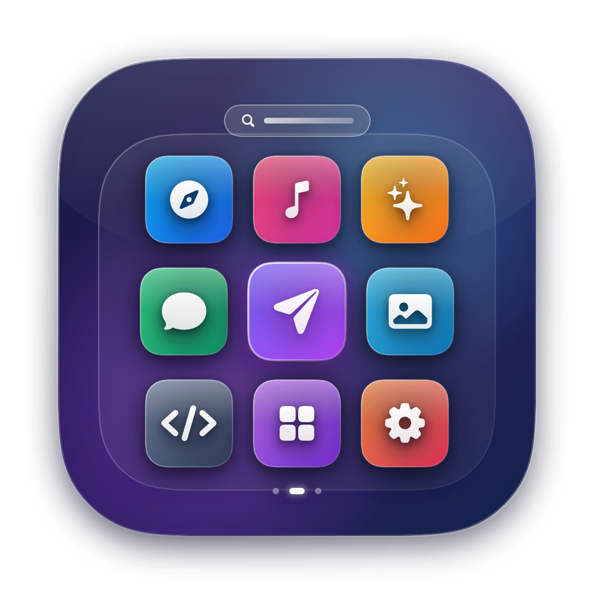
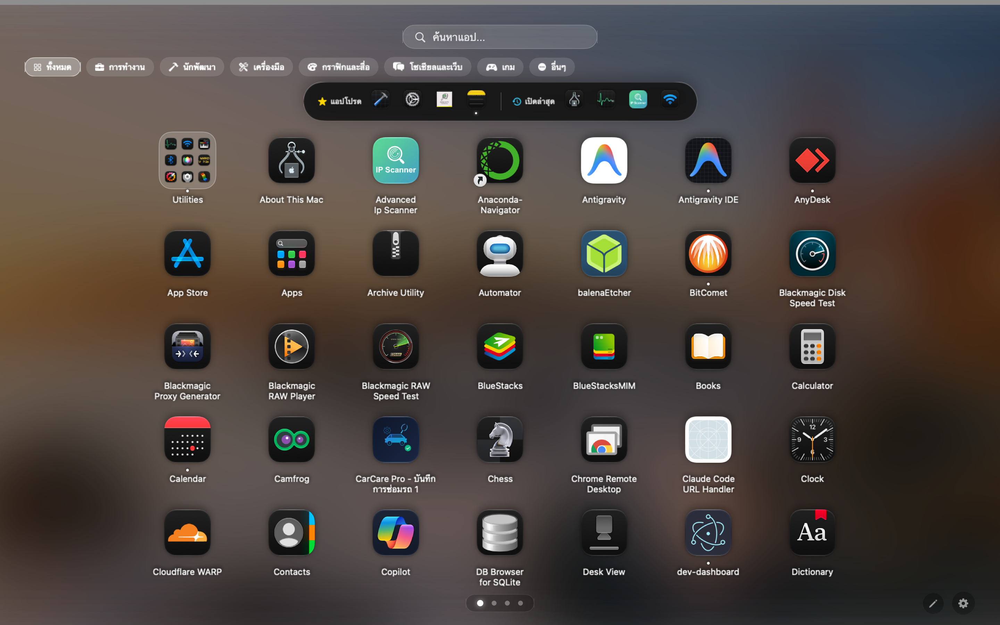
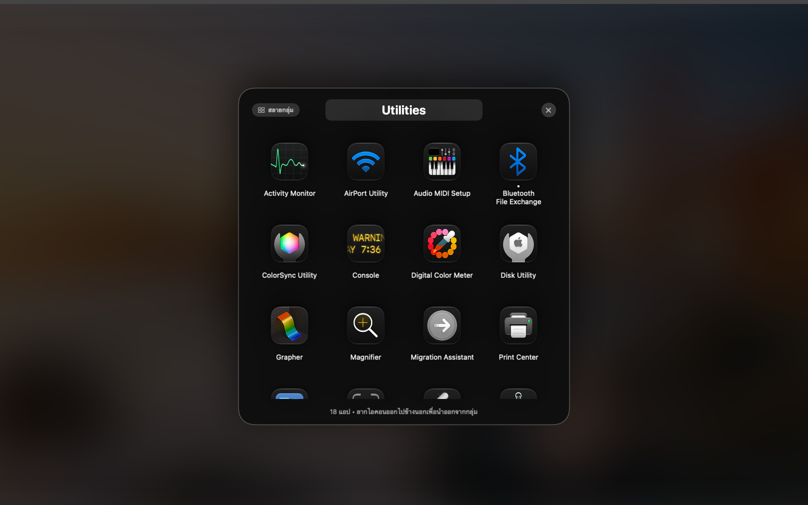
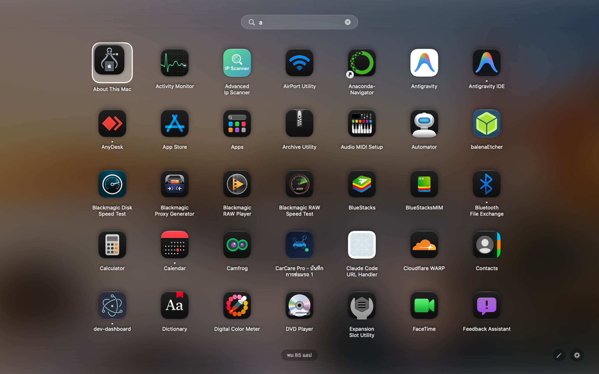
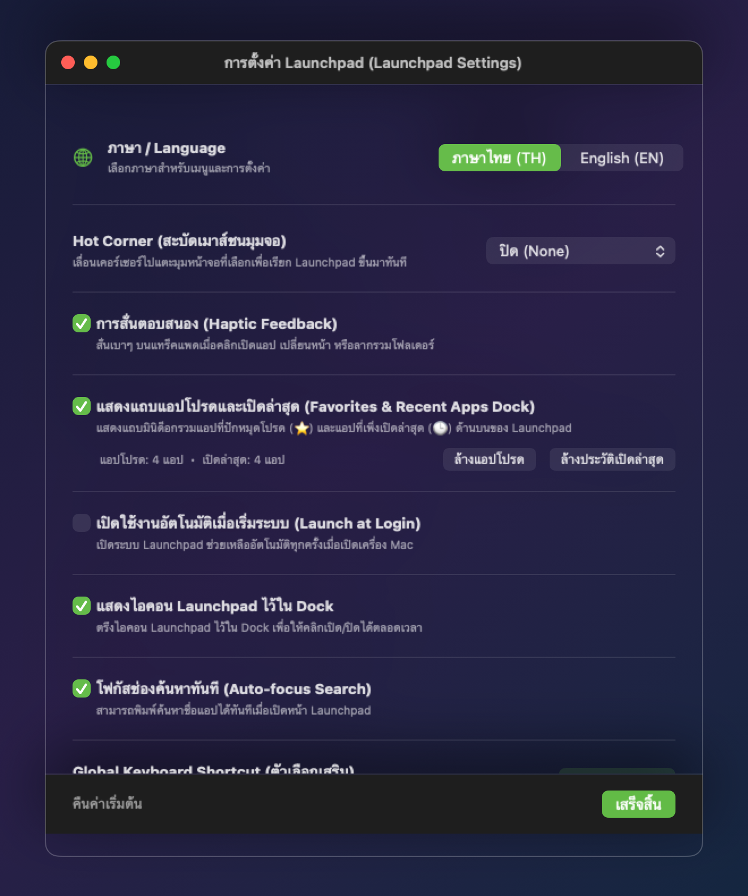

<div align="center">



# Launchpad for macOS

**แอปพลิเคชัน Launchpad แบบเนทีฟระดับ 120Hz ProMotion สำหรับ macOS ยุคใหม่**  
พัฒนาด้วย **Swift 6**, **SwiftUI** และ **AppKit** ถอดแบบความรู้สึกดั้งเดิมของ Apple Launchpad  
พร้อมดีไซน์ **Frosted Glass** จากวอลเปเปอร์จริง ระบบค้นหาอัจฉริยะ 2 ภาษา และการจัดระเบียบแอปครบวงจร

[](https://github.com/warchag/Launchpad)
[](https://swift.org)
[](https://github.com/warchag/Launchpad)
[](https://github.com/warchag/Launchpad/releases)

[**คุณสมบัติเด่น**](#-คุณสมบัติเด่น-key-features) •
[**ภาพหน้าจอ**](#-ภาพตัวอย่างหน้าจอ-screenshots) •
[**การควบคุมและคีย์ลัด**](#-การควบคุมและปุ่มลัด-controls--shortcuts) •
[**วิธีติดตั้ง**](#-วิธีติดตั้ง-installation) •
[**การตั้งค่า**](#️-การตั้งค่า-settings) •
[**Build จากซอร์สโค้ด**](#-การคอมไพล์จากซอร์สโค้ด-build-from-source)

</div>

---

## 📸 ภาพตัวอย่างหน้าจอ (Screenshots)

### 1. หน้าจอหลัก 7 × 5 Grid, หมวดหมู่แอป และแถบ Favorites & Recents Dock
> ตารางมาตรฐาน Apple **7 คอลัมน์ × 5 แถว (35 แอปต่อหน้า)** บนพื้นหลัง Frosted Glass ที่ดึงภาพ Desktop Wallpaper จริงมาเบลอด้วย GPU พร้อมแถบคัดกรองหมวดหมู่ แถบมินิด็อกแอปโปรด/เปิดล่าสุด และจุดไฟแสดงสถานะแอปที่กำลังทำงานอยู่



<br/>

### 2. ระบบจัดกลุ่มโฟลเดอร์ (Glassmorphic Folder View & Drag-to-Reorder)
> เปิดดูโฟลเดอร์ในหน้าต่างกระจกฝ้า เปลี่ยนชื่อโฟลเดอร์ได้ทันที ลากสลับตำแหน่งแอปภายในโฟลเดอร์ ลากแอปออกนอกกรอบเพื่อนำออกจากโฟลเดอร์ หรือกดปุ่ม **สลายกลุ่ม (Ungroup)** ได้ในคลิกเดียว



<br/>

### 3. ระบบค้นหาอัจฉริยะ 2 ภาษา และเลื่อนเลือกด้วยปุ่มลูกศร (Smart Search & Keyboard Navigation)
> พิมพ์ค้นหาได้ทันทีโดยไม่ต้องคลิกช่องค้นหา (**Type-to-Search**) รองรับทั้งชื่อภาษาไทย ชื่อไฟล์ `.app` ภาษาอังกฤษ และตัวย่อ พร้อมไฮไลต์กรอบแอปที่เลือก เลื่อนด้วยปุ่มลูกศร `←` `→` `↑` `↓` และกด `Return` เพื่อเปิดแอปได้ทันที



<br/>

### 4. หน้าต่างการตั้งค่า 2 ภาษา (Bilingual Unified Settings — TH / EN)
> สลับภาษาไทยและอังกฤษได้แบบเรียลไทม์ ปรับแต่งขนาดไอคอน ความเบลอ/ความมืดพื้นหลัง มุมจออัจฉริยะ (Hot Corner) ปุ่มลัดคีย์บอร์ด แถบแอปโปรด และจัดการแอปที่ซ่อนไว้ได้ครบในหน้าเดียว

<div align="center">
  
</div>

---

## ✨ คุณสมบัติเด่น (Key Features)

### 🎨 ดีไซน์และการแสดงผลระดับเนทีฟ (Native Visuals & Performance)
* **Real-Time Frosted Glass Wallpaper**: ดึงภาพวอลเปเปอร์หน้าจอปัจจุบันมาลดขนาดและประมวลผล Gaussian Blur ด้วย GPU Caching (`.drawingGroup()`) ให้ภาพพื้นหลังนุ่มนวลและประหยัดพลังงานสูงสุด
* **มาตรฐานกริด 7 × 5 แบบ Responsive**: แสดงผล **7 คอลัมน์ × 5 แถว (35 แอป/หน้า)** คำนวณระยะห่างอัตโนมัติตามความละเอียดหน้าจอ รองรับทั้งจอ MacBook (ที่มี Notch), iMac, Mac mini และจอมอนิเตอร์ภายนอก
* **120Hz ProMotion Paging & Gesture Lock**: ปาด 2 นิ้วซ้าย/ขวาบน Trackpad ได้ลื่นไหล พร้อมระบบ **Gesture Lock** ล็อก 1 การปาดต่อ 1 หน้า ป้องกันหน้าไหลข้ามจากแรงเฉื่อย (Momentum)
* **Multi-Monitor Hot-Plug Ready**: ปรับขนาดหน้าต่างและอัปเดตวอลเปเปอร์อัตโนมัติทันทีเมื่อเสียบหรือถอดจอแยก

### 🔍 การค้นหาและเปิดแอปความเร็วสูง (Fast Search & Navigation)
* **Type-to-Search ทันใจ**: เปิด Launchpad แล้วพิมพ์ตัวอักษรใดๆ บนคีย์บอร์ดได้ทันที ระบบจะส่งตัวอักษรเข้าช่องค้นหาให้อัตโนมัติแม้ไม่ได้คลิกที่ช่องค้นหา
* **Bilingual & Acronym Smart Search**: ค้นหาเจอทั้งชื่อแอปที่แปลเป็นภาษาไทยและชื่อไฟล์ `.app` ภาษาอังกฤษดั้งเดิม รวมถึงการค้นหาด้วยตัวอักษรย่อ (เช่น พิมพ์ `vsc` เพื่อหา `Visual Studio Code`)
* **Keyboard Arrow Selection**: ใช้ปุ่มลูกศร `←` `→` `↑` `↓` เลื่อนกรอบไฮไลต์เลือกแอปในผลการค้นหา แล้วกด `Return (Enter)` เพื่อเปิดแอปที่เลือกทันที
* **Two-Stage `Esc` Key**: กด `Esc` ครั้งแรกเพื่อล้างคำค้นหา (หรือปิดโฟลเดอร์ที่เปิดอยู่) และกด `Esc` อีกครั้งเพื่อปิด Launchpad

### 🗂️ การจัดระเบียบแอปและโฟลเดอร์ (Organization & Folder Management)
* **Persistent Drag-and-Drop Reordering**: ลากสลับตำแหน่งแอปและโฟลเดอร์ได้อย่างอิสระ และบันทึกตำแหน่งไว้ถาวรแม้ปิดเปิดเครื่องใหม่
* **การจัดการโฟลเดอร์ครบวงจร**:
  * ลากแอปไปวางทับอีกแอปเพื่อสร้างโฟลเดอร์ใหม่
  * ลากสลับตำแหน่งแอปภายในโฟลเดอร์
  * ลากแอปออกนอกกรอบโฟลเดอร์ หรือคลิกขวาเลือก **นำออกจากโฟลเดอร์ (Remove from Folder)**
  * คลิกขวาที่โฟลเดอร์ (หรือกดปุ่มด้านบนโฟลเดอร์) เพื่อ **สลายกลุ่มโฟลเดอร์ (Ungroup Folder)** นำแอปทั้งหมดกลับสู่หน้าหลัก
* **Category Filter Pills**: แถบกรองหมวดหมู่ด้านบน (ทั้งหมด, เครื่องมือพัฒนา, กราฟิกและสื่อ, งานเอกสาร, ยูทิลิตี้, โซเชียล, เกม)
* **Auto File-System Watcher**: ตรวจจับโฟลเดอร์ `/Applications` และ `~/Applications` แบบเรียลไทม์ เมื่อติดตั้งหรือลบแอป รายการใน Launchpad จะอัปเดตเองอัตโนมัติ

### ⭐ แถบมินิด็อกและสถานะการทำงาน (Favorites Dock & Live Status)
* **Favorites & Recent Apps Mini Dock**: แถบกระจกฝ้าด้านบนรวมแอปโปรดที่ปักหมุดไว้ (⭐) และแอปที่เพิ่งเปิดล่าสุด (🕒) พร้อมเอฟเฟกต์ขยายไอคอนเมื่อชี้เมาส์ (Hover Magnification)
* **Running App Indicator & Quick Quit**: แสดงจุดไฟสีขาวใต้ไอคอนแอปและโฟลเดอร์ที่กำลังรันอยู่จริง และสามารถคลิกขวาเลือก **ปิดแอป (Quit App)** ได้ทันทีจากใน Launchpad

---

## 🎮 การควบคุมและปุ่มลัด (Controls & Shortcuts)

| การกระทำ (Action) | วิธีควบคุมด้วยเมาส์ / Trackpad | ปุ่มลัดคีย์บอร์ด (Keyboard) |
| :--- | :--- | :--- |
| **เปิด / ปิด Launchpad** | คลิกไอคอนใน Dock / Status Bar / สะบัดเมาส์ชนมุมจอ (**Hot Corner**) | `⌥ Space` (ปรับเปลี่ยนได้ในการตั้งค่า) |
| **หุบนิ้วเพื่อปิด (Pinch to Close)** | ใช้ 4 หรือ 2 นิ้ว **หุบเข้าหากัน (Pinch In)** บน Trackpad | `Esc` |
| **เลื่อนเปลี่ยนหน้า (Paging)** | ปาด 2 นิ้วซ้าย/ขวา บน Trackpad หรือหมุนลูกกลิ้งเมาส์ | `←` / `→` (เมื่อไม่ได้ค้นหา) |
| **ค้นหาแอปทันที (Type-to-Search)** | คลิกช่องค้นหาด้านบน | พิมพ์ตัวอักษรใดๆ ได้ทันที |
| **เลือกแอปในผลค้นหา** | คลิกซ้ายที่ไอคอนแอป | ปุ่มลูกศร `←` `→` `↑` `↓` แล้วกด `Return` |
| **ล้างคำค้นหา / ปิดโฟลเดอร์ / ปิดหน้าต่าง** | คลิกปุ่ม `✕` หรือคลิกพื้นที่ว่างบนหน้าจอ | `Esc` (กด 1 ครั้งล้างคำค้น / กดซ้ำปิดหน้าต่าง) |
| **เข้าสู่โหมดแก้ไข (Jiggle Edit Mode)** | คลิกค้างที่ไอคอนแอป หรือคลิกปุ่มดินสอ ✏️ มุมขวาล่าง | กด `Esc` เพื่อออกจากโหมดแก้ไข |
| **เมนูคำสั่งด่วน (Context Menu)** | คลิกขวาที่ไอคอนแอป หรือไอคอนโฟลเดอร์ | — |

---

## 🛠️ วิธีติดตั้ง (Installation)

### วิธีที่ 1: ติดตั้งจากไฟล์ `.app` หรือ `.zip`
1. แตกไฟล์ `Launchpad.zip` (หากดาวน์โหลดเป็นไฟล์ซิป) จะได้ไฟล์ **`Launchpad.app`**
2. ลากไฟล์ **`Launchpad.app`** ไปวางไว้ในโฟลเดอร์ **`/Applications`**
3. ลาก **`Launchpad.app`** จาก `/Applications` ลงมาปักหมุดไว้บนแถบ **Dock** เพื่อกดเรียกใช้งานได้สะดวกเหมือน Launchpad ดั้งเดิม
4. *(ตัวเลือกเสริม)* เปิดหน้าต่างการตั้งค่าของแอป แล้วเปิดใช้งาน **"เปิดใช้งานอัตโนมัติเมื่อเข้าสู่ระบบ (Launch at Login)"**

> [!TIP]
> หากเปิดครั้งแรกแล้ว macOS แจ้งเตือนเรื่องความปลอดภัย ให้เปิดผ่านการคลิกขวาที่ `Launchpad.app` แล้วเลือก **Open** หรือรันคำสั่ง `xattr -cr /Applications/Launchpad.app` ใน Terminal

---

## ⚙️ การตั้งค่า (Settings)

เปิดหน้าต่างการตั้งค่าได้โดยคลิกปุ่ม **ฟันเฟือง (⚙️)** มุมขวาล่างของหน้าจอ Launchpad หรือคลิกขวาที่ไอคอนบนแถบเมนูด้านบน (Status Bar):

* **🌐 ภาษา (Language)**: สลับระหว่าง **ภาษาไทย (TH)** และ **English (EN)** ทันทีทั้งโปรแกรม
* **📐 การจัดเรียงและขนาดไอคอน**:
  * ปรับขนาดไอคอน (`64 px` – `96 px`, ค่าเริ่มต้น `82 px`) บนตารางมาตรฐาน `7 × 5`
  * จัดเรียงตามตัวอักษร ก-ฮ / A-Z อัตโนมัติ หรือกดปุ่มจัดเรียงทันที
  * ซิงค์โฟลเดอร์เริ่มต้นของ macOS (เช่น `Utilities` และ `Other`)
* **🖼️ ภาพพื้นหลังและความโปร่งใส**:
  * ปรับระดับความเบลอของวอลเปเปอร์ (`Wallpaper Blur`) และความมืดพื้นหลัง (`Background Dimming`)
* **⚡ การเปิดใช้งานและปุ่มลัด**:
  * เปิดอัตโนมัติเมื่อเข้าสู่ระบบ (`Launch at Login`)
  * แสดงหรือซ่อนไอคอนใน Dock
  * โฟกัสช่องค้นหาอัตโนมัติเมื่อเปิดหน้าต่าง
  * ตั้งค่า **มุมจออัจฉริยะ (Hot Corner)** ทั้ง 4 มุมจอ
  * ตั้งค่า **ปุ่มลัดคีย์บอร์ด (Global Shortcut)** (`⌥ Space`, `⌃ Space`, `⌘ ⇧ L`, `F4`)
  * เปิด/ปิดการสั่นตอบสนองบนแทร็คแพด (`Haptic Feedback`)
* **⭐ แถบแอปโปรด & แอปที่ซ่อนไว้**:
  * เปิด/ปิดแถบแอปโปรดและเปิดล่าสุด พร้อมปุ่มล้างประวัติ
  * ดูรายการแอปที่ถูกซ่อนไว้ และกดกู้คืนกลับมาแสดงผลได้ตลอดเวลา

---

## 💻 การคอมไพล์จากซอร์สโค้ด (Build from Source)

### โครงสร้างโปรเจกต์ (Project Structure)

```text
Launchpad/
├── Package.swift                  # Swift Package Manager manifest (macOS 14+)
├── package_app.sh                 # สคริปต์ Build Release Binary และสร้าง Launchpad.app
├── make_icon.swift                # สคริปต์ SwiftUI เรนเดอร์ไอคอน AppIcon.png และ AppIcon.icns
├── Resources/
│   ├── AppIcon.png                # ไอคอนแอปความละเอียด 1024×1024
│   └── AppIcon.icns               # ชุดไอคอนมาตรฐาน macOS Bundle
└── Sources/Launchpad/
    ├── App/                       # จุดเริ่มต้นแอป (LaunchpadApp, AppDelegate, GlobalHotkeyManager)
    ├── Models/                    # โมเดลข้อมูล (AppScanner, AppSettings,AppItem, WallpaperManager)
    ├── Views/                     # หน้าจอ SwiftUI (LaunchpadOverlayView, FolderDetailView, SettingsView ฯลฯ)
    └── Window/                    # การจัดการหน้าต่างไร้ขอบและอีเวนต์ (LaunchpadWindowController)
```

### คำสั่ง Build และสร้าง `.app` Bundle

```bash
# 1. เข้าสู่โฟลเดอร์โปรเจกต์
cd Launchpad

# 2. (ตัวเลือกเสริม) สร้างไฟล์ไอคอน AppIcon.icns ใหม่ด้วย SwiftUI Renderer
swift make_icon.swift

# 3. คอมไพล์โหมด Release และสร้าง Launchpad.app พร้อม Code Sign
./package_app.sh
```

เมื่อรันเสร็จสิ้น จะได้ไฟล์ **`Launchpad.app`** ที่พร้อมใช้งานทันทีในโฟลเดอร์โปรเจกต์

---

## 📋 ความต้องการของระบบ (System Requirements)

* **ระบบปฏิบัติการ**: macOS 14.0 (Sonoma), macOS 15.0 (Sequoia), macOS 26 (Tahoe) หรือใหม่กว่า
* **สถาปัตยกรรมซีพียู**: รองรับทั้ง **Apple Silicon** (`M1` / `M2` / `M3` / `M4` / `M5`) และ **Intel Mac**

---

## 👨‍💻 ผู้พัฒนาและการสนับสนุน (Developer & Support)

พัฒนาและดูแลโดย **Worracag Kongnoo (นายวรจักร คงหนู)**

* **GitHub Repository**: [github.com/warchag/Launchpad](https://github.com/warchag/Launchpad)
* **Facebook Page**: [Learn to Developer](https://www.facebook.com/learntodeveloper)
* **สนับสนุนผู้พัฒนา (Buy Me a Coffee / PromptPay)**: พร้อมเพย์ `095-920-1930` (นายวรจักร คงหนู — สามารถสแกน QR Code ด้านล่าง หรือสแกนได้โดยตรงภายในหน้าต่างตั้งค่าของแอป)

<div align="center">
  
</div>
